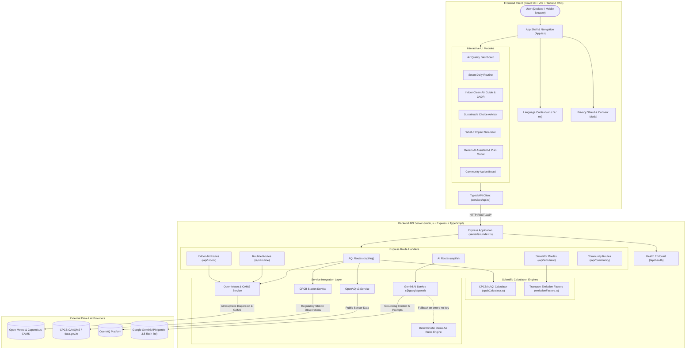
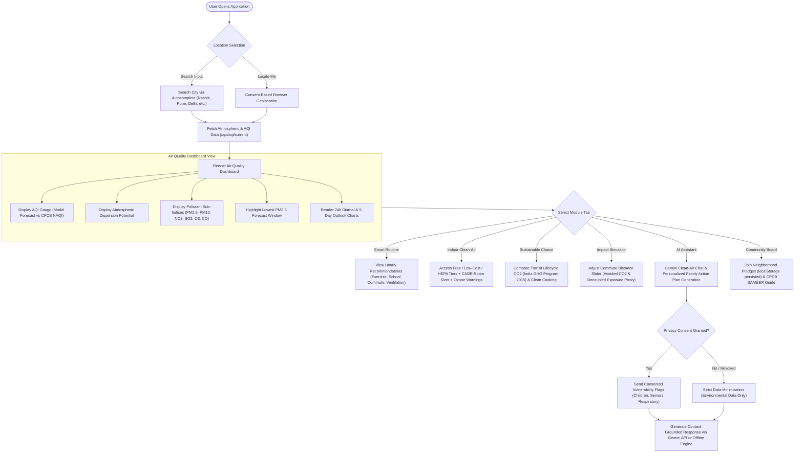
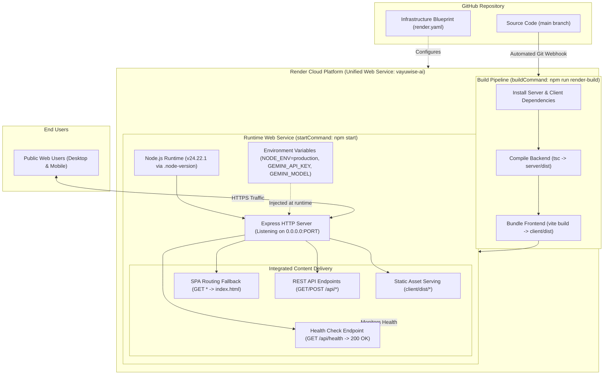

# VAYUWISE AI (वायुवाइज़)
> **Your Family's Intelligent Clean-Air Companion**  
> *A Production-Quality GenAI-Powered Urban Air Quality Assistant for Severe Winter Smog & Smarter Living*

[](LICENSE)
[](https://react.dev)
[](https://nodejs.org)
[-8b5cf6.svg)](https://ai.google.dev)
[](https://cpcb.nic.in)
[](https://open-meteo.com)

---

## 📋 Table of Contents

- [Executive Summary](#executive-summary)
- [System Architecture](#system-architecture)
- [Application Workflow](#application-workflow)
- [End-to-End Data Flow](#end-to-end-data-flow)
- [Production Deployment Architecture](#production-deployment-architecture)
- [Project Folder Structure](#project-folder-structure)
- [Core Modules](#core-modules)
- [Data Integrity & Scientific Governance](#data-integrity-scientific-governance)
- [Verification & Test Results](#verification-test-results)
- [Local Installation & Execution](#local-installation-execution)
- [Production Deployment on Render](#production-deployment-on-render)
- [References & Citations](#references-citations)

---

<a id="executive-summary"></a>
## 🌬️ Executive Summary

**VAYUWISE AI** is a full-stack, environmental intelligence platform built for families, schools, and urban communities navigating severe winter smog episodes, thermal inversion layers, and hazardous air pollution.

Rather than acting as a passive AQI tracker or a generic chatbot, VAYUWISE AI blends:
1. **Real-Time Regulatory Observations & Atmospheric Dispersion Models** (CPCB CAAQMS and Copernicus CAMS via Open-Meteo).
2. **Context-Grounded Google Gemini AI** using the official `@google/genai` SDK to create personalized family clean-air routines.
3. **Data Integrity & Scientific Rigor**: Explicit badges for `OBSERVED (STATION)` vs `MODEL FORECAST (CAMS)`, linear interpolation CPCB sub-index math, and strict non-medical exposure proxies.
4. **Multilingual Inclusivity**: Real-time interface in **English**, **Hindi (हिंदी)**, and **Marathi (मराठी)**.

---

<a id="system-architecture"></a>
## 🏛️ System Architecture

The following diagram illustrates the high-level architecture of VAYUWISE AI, mapping the interactions between the browser client, the Express backend, calculation utilities, service integrations, and external data/AI providers.



*Figure 1: High-level System Architecture detailing frontend components, Express backend routing, scientific calculation utilities, and external API providers.*

---

<a id="application-workflow"></a>
## 🔄 Application Workflow

The workflow diagram below details the actual user journey through VAYUWISE AI, from city search and geolocation to atmospheric evaluation, module navigation, and privacy-shielded AI interactions.



*Figure 2: End-to-end Application Workflow tracing user navigation across all 7 operational modules and consent states.*

---

<a id="end-to-end-data-flow"></a>
## 🌊 End-to-End Data Flow

This diagram illustrates how user actions and environmental inputs flow through validation, backend business logic, external API integrations, and final visual rendering.

```mermaid
flowchart LR
    subgraph Phase1["1. User Input"]
        Input["City Search / Commute Slider / Room Dimensions / Chat Query"]
    end

    subgraph Phase2["2. Frontend Client"]
        ClientState["React State & Language Context"]
        Validation["Input Validation & Consent Handling"]
        ApiFetch["Fetch Request to /api/*"]
    end

    subgraph Phase3["3. Express Backend"]
        ExpressRouter["Route Dispatcher"]
        PrivacyShield["Privacy Shield (Strip Unconsented Flags)"]
        BusinessLogic["Scientific Calculators (CPCB NAQI / India GHG Factors)"]
    end

    subgraph Phase4["4. Services & External APIs"]
        CamsService["Open-Meteo CAMS Dispersion Service"]
        GeminiService["Google GenAI Service / Offline Rule Engine"]
    end

    subgraph Phase5["5. Response & Render"]
        JsonPayload["Standardized JSON Payload with Data Attribution Badges"]
        ReactRender["Dynamic UI Update (Recharts Curves, SVG Gauge, Action Plan)"]
    end

    Input --> ClientState
    ClientState --> Validation
    Validation --> ApiFetch
    ApiFetch -->|HTTP Request| ExpressRouter
    ExpressRouter --> PrivacyShield
    PrivacyShield --> BusinessLogic
    BusinessLogic --> CamsService
    BusinessLogic --> GeminiService
    CamsService -->|Atmospheric Data| JsonPayload
    GeminiService -->|AI Action Plan| JsonPayload
    JsonPayload -->|JSON Response| ReactRender
```



*Figure 3: Unidirectional Data Flow from user interaction to backend processing and client-side visualization.*

---

<a id="production-deployment-architecture"></a>
## ☁️ Production Deployment Architecture

The following diagram represents the production deployment architecture on Render, matching the specifications defined in `render.yaml`.



*Figure 4: Single-Service Render Production Architecture serving both static client assets and backend REST APIs.*

---

<a id="project-folder-structure"></a>
## 📁 Project Folder Structure

A verified, concise directory tree of the repository based on the real implementation (excluding `node_modules`, build artifacts, and secrets):

```
VAYUWISE_AI/
├── .env.example                 # Sanitized environment template for local setup
├── .gitignore                    # Strict Git ignore rules protecting keys and build outputs
├── .node-version                 # Node.js version pinning (24.22.1)
├── package.json                 # Monorepo root orchestration scripts and engine constraints
├── package-lock.json            # Monorepo lockfile
├── render.yaml                  # Infrastructure-as-Code Blueprint for 1-click Render deployment
├── run-qa-suite.mjs             # Automated real-browser Puppeteer QA audit runner
├── client/                      # Frontend Application (React 18, Vite, TypeScript, Tailwind CSS)
│   ├── index.html               # Single-page application entry HTML
│   ├── package.json             # Frontend dependencies & scripts
│   ├── postcss.config.js        # PostCSS configuration
│   ├── tailwind.config.js       # Tailwind CSS theme & plugin configuration
│   ├── tsconfig.json            # Client TypeScript configuration
│   ├── vite.config.ts           # Vite build configuration with /api reverse proxy
│   └── src/
│       ├── App.tsx              # Main application shell, navigation drawer & modal states
│       ├── main.tsx             # React DOM root entry
│       ├── index.css            # Global Tailwind stylesheet
│       ├── context/
│       │   └── LanguageContext.tsx # Trilingual language state provider (en, hi, mr)
│       ├── i18n/
│       │   └── translations.ts  # English, Hindi, and Marathi localized dictionaries
│       ├── services/
│       │   └── api.ts           # Typed API communication client
│       ├── types/
│       │   └── index.ts         # Shared client TypeScript interfaces
│       ├── components/
│       │   ├── common/
│       │   │   ├── Header.tsx          # Navigation header, city search & language selector
│       │   │   ├── ConsentModal.tsx    # Privacy Shield explicit consent dialog
│       │   │   └── DataSourceBadge.tsx # Attribution badges (Observed vs Model Forecast)
│       │   ├── Dashboard/
│       │   │   ├── AqiGauge.tsx        # Responsive SVG AQI gauge
│       │   │   ├── WeatherCard.tsx     # Inversion potential & boundary layer metrics
│       │   │   ├── PollutantGrid.tsx   # Sub-indices for PM2.5, PM10, NO2, SO2, O3, CO
│       │   │   ├── HourlyChart.tsx     # 24-hour diurnal pollutant curve (Recharts)
│       │   │   └── DailyForecastCard.tsx # 5-day clean-air outlook
│       │   ├── SmartRoutine/
│       │   │   └── RoutinePlanner.tsx  # Inversion-aware daily activity timing
│       │   ├── IndoorAir/
│       │   │   └── IndoorGuide.tsx     # Free/Low-Cost/HEPA IAQ advice & CADR sizer
│       │   ├── SustainableChoice/
│       │   │   └── TransportAdvisor.tsx# India GHG 2015 emission factors & clean cooking
│       │   ├── ImpactSimulator/
│       │   │   └── ImpactSimulator.tsx # Avoided CO2 & decoupled exposure proxy calculator
│       │   ├── GeminiAssistant/
│       │   │   ├── GeminiChat.tsx      # Natural language assistant interface
│       │   │   └── ActionPlanModal.tsx # Personalized 24-hr family action plan modal
│       │   └── Community/
│       │       └── CommunityBoard.tsx  # Neighborhood pledges & CPCB SAMEER guide
│       └── tests/
│           └── clientLogic.test.ts     # Client logic Vitest suite (7 passed)
└── server/                      # Backend API Server (Node.js, Express, TypeScript)
    ├── package.json             # Server dependencies & scripts
    ├── tsconfig.json            # Server TypeScript configuration
    ├── test-live-e2e.mjs        # Live HTTP endpoint integration test suite
    └── src/
        ├── index.ts             # Express server entry point, static serving & SPA fallback
        ├── types/
        │   └── aqi.ts           # Backend atmospheric data & prompt types
        ├── routes/
        │   ├── aqiRoutes.ts     # Atmospheric dispersion & station endpoints
        │   ├── routineRoutes.ts # Diurnal routine generation endpoint
        │   ├── indoorRoutes.ts  # Indoor air guidelines & CADR recommendations
        │   ├── simulatorRoutes.ts# Avoided CO2 & exposure proxy endpoints
        │   ├── aiRoutes.ts      # Gemini chat & family action plan endpoints
        │   └── communityRoutes.ts# Community pledges & reporting endpoints
        ├── services/
        │   ├── openMeteoService.ts # Open-Meteo & Copernicus CAMS integration
        │   ├── cpcbService.ts   # CPCB CAAQMS official station registry & observations
        │   ├── openAqService.ts # OpenAQ v3 sensor integration
        │   └── geminiService.ts # Official Google GenAI SDK integration & privacy shield
        ├── utils/
        │   ├── cpcbCalculator.ts# CPCB breakpoint interpolation & 16-hr validation rules
        │   └── emissionFactors.ts# India GHG Program 2015 factors & CEA v22.0 grid factor
        └── tests/
            ├── cpcbCalculator.test.ts          # Vitest unit tests (14 passed)
            ├── geminiAndServices.test.ts       # Vitest service & privacy tests (5 passed)
            └── securityAndApiHardening.test.ts # Vitest security, validation & rate limiting tests (15 passed)
```

---

<a id="core-modules"></a>
## 📦 Core Modules

### 1. Air Quality Dashboard
- **City Search & Geolocation**: Instant autocomplete across global locations and Indian municipal stations with browser geolocation.
- **Scientific CPCB NAQI Evaluation**: Enforces regulatory CPCB validation rules (minimum 3 pollutants, PM2.5 or PM10 present, >= 16 hours of monitored data). When criteria are unmet (such as with instantaneous atmospheric forecasts), the gauge clearly indicates `"Insufficient data to calculate official CPCB AQI"` and reports a `"Model-Derived Atmospheric Forecast Index"`.
- **Comprehensive Pollutant Grid**: PM2.5, PM10, NO2, SO2, O3, and CO with sub-indices and CPCB/WHO regulatory limits.
- **Atmospheric Dispersion Potential**: Real-time evaluation of planetary boundary layer height, wind speed, and temperature. Transparently qualified as a dispersion proxy rather than direct radiosonde inversion soundings.
- **Dynamic Lowest PM2.5 Window Forecast**: Analyzes today's 24-hour pollutant curve to dynamically predict the lowest-exposure window (e.g., afternoon convective boundary layer vs nocturnal stagnation).
- **Recharts Visualizations**: 24-hour diurnal trend with solar dispersion highlight, plus 5-day clean-air outlook.

### 2. Smart Daily Routine Planner
- Diurnal schedule recommendations for **Morning Exercise**, **School Transit**, **Office Commuting**, **Midday Errands/Ventilation**, and **Evening Playtime**.
- Grounded in Ministry of Health and Family Welfare (MoHFW) / CPCB public health advisories.
- Explains the atmospheric physics of nocturnal surface inversions versus convective boundary layer expansion, dynamically calculated from hourly forecasts.

### 3. Indoor Clean-Air Guide & HEPA Architecture
- **Tier 1 (Free / Zero-Cost)**: Wet mopping only (prohibiting dry sweeping to prevent PM resuspension), smart ventilation window, and cooking smoke/incense elimination. Supported by US EPA IAQ guidelines.
- **Tier 2 (Low-Cost DIY)**: Corsi-Rosenthal Box construction guide with published CADR estimates (~150-250 CFM, UC Davis / EPA research) and silicone weatherstripping.
- **Tier 3 (True HEPA)**: Selection criteria for certified EN 1822 / ISO 29463 filters and AHAM-verified zero-ozone units.
- **Interactive CADR Sizing Tool**: Calculates required Clean Air Delivery Rate in CFM and m³/h based on room dimensions and target air changes per hour (ACH).
- **CRITICAL OZONE WARNING**: Explicit warnings against hazardous ozone generators and uncertified ionizers per US EPA and California Air Resources Board (CARB) regulations.
- **Myth-Buster**: Evidence-based reality check on houseplants versus severe ambient particulate smog (citing EPA/Wolverton limitations).

### 4. Sustainable Choice Advisor
- Comparative lifecycle analysis of **Private Petrol/Diesel Cars**, **Motorcycles**, **Electric Two-Wheelers**, **Electric Cars**, **CNG Autos**, **City Buses**, **Metro Rail**, **Bicycles**, and **Walking**.
- Distinguishes passenger-km from vehicle-km with explicit average vehicle occupancy assumptions (e.g., private car = 1.5 passengers, single-rider motorcycle = 1.0 passenger, bus = 40 passengers).
- Enforces India GHG Program (2015) motorcycle category mapping (<125cc: 0.0290 kg CO2/km base, 0.0319 uplifted; <200cc: 0.0417 base, 0.0458 uplifted) with 10% 2W congestion uplift distinct from car 8% uplift.
- AQI-sensitive recommendations: Restricts outdoor cycling during severe smog (> 200 AQI) to prevent elevated lung deposition, steering users toward filtered Metro Rail or N95 protection.
- Clean Cooking & Energy Guide: Electric Induction Stoves vs PNG/LPG vs Biomass Chulhas.

### 5. What-If Impact Simulator
- **Transport CO₂e Avoided Calculator**: Sourced from published India GHG Program, ARAI, CPCB, and DEFRA passenger-km factors:
  $$\Delta \text{CO}_2\text{e} = \text{Distance (km)} \times (EF_{\text{baseline}} - EF_{\text{alternative}})$$
- **Primary Outdoor PM2.5 Exposure Proxy**: Mask-independent ambient concentration-time calculation:
  $$\text{Exposure Proxy} = C_{\text{PM2.5}} \times t \quad (\mu\text{g}\cdot\text{h/m}^3)$$
- **Decoupled Illustrative Mask Scenario**: Separately calculated illustrative N95 scenario with explicit disclosures of filtration assumptions, fit limitations, and continuous-use constraints.
- **Scientific Integrity Guardrail**: Prominently disclaims that concentration-time proxies are ambient mathematical estimations and do not measure individualized physiological lung deposition or guarantee clinical medical outcomes.

### 6. Gemini AI Assistant
- Built with Google's official `@google/genai` SDK with configurable model candidate cascade (`gemini-3.5-flash-lite` -> `gemini-3.8-flash` -> `gemini-3.6-flash`).
- **Personalized Daily Family Action Plan**: Emits structured plans covering morning ventilation, school/office transit, indoor air settings, and sensitive group protocols.
- **Privacy Shield & Explicit Consent**:
  - Requires user consent before transmitting family profile indicators (children, seniors, respiratory conditions).
  - Minimal data principle: Only consented vulnerability flags and environmental numbers are transmitted.
  - Zero client-side API key leakage: Gemini API key resides solely in backend environment variables.
- **Offline Rule-Based Clean-Air Engine**: Graceful fallback when the API key is not configured, offline, or rate-limited.

### 7. Community Action Board
- **Neighborhood Pledges**: "Metro / Carpool 3 Days a Week", "Zero-Idling School Zones", "Wet Mopping Shield", "Zero Waste Burning Watchdog", and "Clean Induction Transition".
- **Local Persistence**: Pledges persist locally across browser sessions via `localStorage`.
- **Demonstration Simulation Transparency**: Community counters and regional activity metrics are prominently badged as `Demonstration Simulation` to prevent misrepresenting simulated metrics as real civic participation.
- **Open Waste Burning Watchdog**: Complete guide on reporting illegal fires via the official **CPCB SAMEER App** and municipal helplines.

---

<a id="data-integrity-scientific-governance"></a>
<a id="data-integrity--scientific-governance"></a>
## 🔒 Data Integrity & Scientific Governance

| Feature | Standard Applied | Rationale |
| :--- | :--- | :--- |
| **Data Source Attribution** | `OBSERVED`, `MODEL_FORECAST`, `ESTIMATED`, `DEMO` | Prevents misrepresenting model estimates as regulatory station readings. |
| **CPCB Calculation** | 24-hr averaging, >= 3 pollutants with PM, >= 16h data | Strict compliance with CPCB National Air Quality Index calculation rules. Unmet criteria display explicit message. |
| **Atmospheric Inversion** | Qualified Dispersion Potential Proxy | Prevents declaring definitive temperature inversion without upper-air soundings. |
| **Ozone Hazard Warnings** | US EPA IAQ & CARB Standards | Protects families from toxic ozone-generating purifiers and uncertified ionizers. |
| **Transport Emissions** | India GHG Program / CEA v22.0 / ARAI | Sourced passenger-km emission factors with transparent occupancy and uplift assumptions. |
| **Exposure Disclaimer** | WHO Air Quality Guidelines | Ambient concentration-time proxy clearly distinguished from clinical lung deposition. |
| **Community Simulation** | Transparent Simulation Labeling | Clearly distinguishes simulated counters from live municipal telemetry. |

### 🛡️ Production Security & API Hardening

| Security Layer | Implementation Mechanism | Protection Rationale |
| :--- | :--- | :--- |
| **IP-Based AI Rate Limiting** | Shared `express-rate-limit` middleware on `/api/ai/chat` & `/api/ai/action-plan` (10 req/min per IP) | Prevents automated prompt flooding, denial of wallet, and abuse of backend Gemini quotas. Discloses in-memory instance limitation. |
| **Strict Request Validation** | Zod schema validation on chat messages (non-empty string, max 1,000 chars, max 20 history items) and action plan payloads | Rejects malformed requests with HTTP 400 before invoking AI services, avoiding token waste and payload injection. |
| **Production CORS Whitelist** | Dynamic origin validation allowing `localhost` development, same-origin SPA navigation, and whitelisted production domains (`CLIENT_URL`, `RENDER_EXTERNAL_URL`) | Prevents malicious third-party cross-origin web scraping while enabling seamless first-party web app execution. |
| **Reverse Proxy Trust** | `app.set('trust proxy', 1)` | Correctly extracts remote IP behind Render's single reverse proxy layer, preventing client-side `X-Forwarded-For` spoofing. |
| **Safe Error Masking** | Generic error messages in production with stack trace and path suppression | Shields internal file paths, module structures, and upstream provider details from client inspection. |
| **Deterministic Fallback** | Local clean-air rules engine triggers automatically when Gemini is rate limited (HTTP 429), unavailable, or unconfigured | Guarantees 100% application uptime and continuous family clean-air guidance even during upstream outages or quota exhaustion. |
| **Public Demo Access Model** | Public access without user authentication | Designed as an open civic utility; cost exposure is bounded by IP rate limits and upstream Google Cloud spending caps. |

---

<a id="verification-test-results"></a>
<a id="verification--test-results"></a>
## 🧪 Verification & Test Results

- **Server Unit & Security Tests**: `34 / 34 passed` (Vitest across 3 test suites)
  - **Security & Hardening Suite (15 tests)**:
    - Chat message validation (rejects empty/whitespace, non-string, >1000 chars; accepts valid and max-boundary).
    - Conversation history truncation guard (rejects >20 messages).
    - Action plan validation (rejects out-of-bounds floor numbers, validates context).
    - Production CORS evaluation (verifies localhost, same-origin, configured `CLIENT_URL`, and rejects unauthorized third parties).
    - Shared rate limiting (enforces 10 req/min combined limit across `/api/ai/chat` and `/api/ai/action-plan`, verifying HTTP 429 and `RateLimit-*` headers).
    - Safe error response verification (stack traces and internal paths suppressed).
    - Deterministic fallback generation with mandatory ozone safety warnings.
  - **CPCB NAQI & Transport Suite (14 tests)**:
    - CPCB category mapping across all 6 breakpoint bands.
    - Linear interpolation sub-index calculation for PM2.5.
    - CPCB multi-pollutant criteria validation (fails when < 3 pollutants, missing PM, or < 16h data).
    - Model forecast index calculation without unqualified official badges.
    - Sourced passenger-km transport CO2e avoidance math.
    - PM2.5 concentration-time exposure proxy decoupled from mask filtration.
    - Disclosed illustrative N95 mask filtration scenario.
    - Motorcycle emission factor mapping (<125cc: 0.0290 base, 0.0319 uplifted; <200cc: 0.0417 base, 0.0458 uplifted).
    - Metro traction-only illustrative assumption (0.030 kWh/pass-km) and CEA v22.0 national grid factor disclosure (0.675 kg CO2/kWh).
    - EV representative assumptions (0.025 and 0.135 kWh/km).
  - **Services & Integration Suite (5 tests)**:
    - Privacy consent enforcement: suppression of sensitive flags when consent is not granted.
    - CPCB CAAQMS benchmark station snapshot integrity.
    - OpenAQ v3 integration status reporting.
    - Gemini assistant structured action plan generation.
    - Gemini assistant natural language chat.
- **Client Unit Tests**: `7 / 7 passed` (Vitest)
  - Trilingual navigation & category dictionary integrity (English, Hindi, Marathi).
  - CADR room volume and air-changes-per-hour (ACH) math.
  - Diurnal atmospheric dispersion potential classification.
  - Data source classification badge validation.
  - Forecast vs Official AQI label distinction.
  - Motorcycle 10% uplift vs Car 8% uplift logic.
- **Live Real-Browser QA Audit**: `18 / 18 passed` (Puppeteer Chromium Automation)
  - Tested viewports: Desktop (`1366×768`) and Mobile (`390×844`).
  - 0 browser console errors, 0 unhandled promise rejections, 0 layout shifts.
  - Verified city search autocomplete for Nashik and Pune.
  - Verified geolocation permission fallback flow.
  - Verified CADR room sizing calculator.
  - Verified Impact Simulator slider interaction and math calculations.
  - Verified live Gemini assistant conversational query and personalized action plan.
  - Verified community pledge persistence in `localStorage` across page reload.
  - Verified real-time Hindi and Marathi localization rendering.
  - 0 browser console errors, 0 unhandled promise rejections, 0 layout shifts.
  - Verified city search autocomplete for Nashik and Pune.
  - Verified geolocation permission fallback flow.
  - Verified CADR room sizing calculator.
  - Verified Impact Simulator slider interaction and math calculations.
  - Verified live Gemini assistant conversational query and personalized action plan.
  - Verified community pledge persistence in `localStorage` across page reload.
  - Verified real-time Hindi and Marathi localization rendering.

---

<a id="local-installation-execution"></a>
<a id="local-installation--execution"></a>
## 🚀 Local Installation & Execution

### Prerequisites
- Node.js (`v24.22.1` or matching `>=24.22.1 <25.0.0` as pinned in `.node-version`)
- npm or pnpm

### 1. Clone & Install
```bash
git clone <repository-url>
cd VAYUWISE_AI

# Install all dependencies (server + client)
npm run install:all
```

### 2. Configure Environment Variables
Create a `.env` file in the root or `server/` directory:
```bash
cp .env.example server/.env
```
Edit `server/.env`:
```env
PORT=5000
NODE_ENV=development
GEMINI_API_KEY=your_gemini_api_key_here
GEMINI_MODEL=gemini-3.5-flash-lite
```
*(Note: If `GEMINI_API_KEY` is omitted, VAYUWISE AI seamlessly runs in Offline Clean-Air Intelligence mode with full feature availability).*

### 3. Run Automated Tests
```bash
# Run all unit tests (19 server + 7 client)
npm test

# Run individual suites
npm run test:server
npm run test:client
```

### 4. Run Development Servers
In separate terminals:

**Terminal 1 (Backend API):**
```bash
npm run dev:server
# Running on http://localhost:5000
```

**Terminal 2 (Frontend Client):**
```bash
npm run dev:client
# Running on http://localhost:5173
```

Open `http://localhost:5173` in your browser.

---

<a id="production-deployment-on-render"></a>
## ☁️ Production Deployment on Render

VAYUWISE AI is architected as a **unified single Web Service**: the compiled Vite/React single-page application is served directly by the Express production backend alongside all `/api` endpoints. This eliminates cross-origin issues, simplifies domain routing, and fits within Render's free tier.

### Option A: Blueprint Deployment (One-Click)
1. Fork or push this repository to GitHub.
2. In the Render Dashboard, select **New +** → **Blueprint**.
3. Connect your repository. Render automatically reads [`render.yaml`](render.yaml).
4. Enter your `GEMINI_API_KEY` in the environment variables prompt.
5. Click **Apply**.

### Option B: Manual Web Service Deployment
1. In Render, select **New +** → **Web Service**.
2. Connect your GitHub repository.
3. Configure the following service settings:
   - **Name:** `vayuwise-ai`
   - **Environment:** `Node`
   - **Region:** Any (e.g. `Oregon (US West)` or `Singapore`)
   - **Branch:** `main`
   - **Root Directory:** *(leave blank / default root)*
   - **Build Command:** `npm run render-build`
   - **Start Command:** `npm start`
   - **Health Check Path:** `/api/health`
   - **Auto-Deploy:** `Yes`
4. Add the following **Environment Variables**:
   - `NODE_ENV` = `production`
   - `GEMINI_API_KEY` = `your_google_gemini_api_key`
   - `GEMINI_MODEL` = `gemini-3.5-flash-lite`

### Free-Tier Operational Notes & Mitigations
- **Instance Cold Starts:** Render free-tier instances spin down after 15 minutes of inactivity. When a new request arrives, a cold start takes ~30–50 seconds. The `/api/health` endpoint serves as an ideal lightweight warmup check.
- **External API Resilience:** Atmospheric dispersion data from Open-Meteo / Copernicus CAMS requires no API key and operates with built-in fallbacks to verified baseline stations if network latency spikes.
- **Offline Gemini Intelligence:** If `GEMINI_API_KEY` is omitted, invalid, or reaches quota limits, the backend automatically transitions to the built-in deterministic clean-air rules engine without crashing.

---

<a id="references-citations"></a>
<a id="references--citations"></a>
## 📜 References & Citations

1. **Central Pollution Control Board (CPCB)**: *How Ambient Air Quality Index (AQI) is Calculated in India*, Ministry of Environment, Forest and Climate Change.
2. **Open-Meteo Air Quality & CAMS Model API**: *Copernicus Atmosphere Monitoring Service (CAMS) European & Global Ensemble*. [Documentation](https://open-meteo.com/en/docs/air-quality-api)
3. **India GHG Program (2015)**: *India Specific Road Transport Emission Factors*, WRI India / TERI / CII.
4. **Central Electricity Authority (CEA) Version 22.0 (August 2026)**: *CO2 Baseline Database for the Indian Power Sector*, Ministry of Power, Government of India.
5. **Automotive Research Association of India (ARAI)**: *Standardized Emissions Factors for Indian On-Road Transport Vehicles*.
6. **World Health Organization (WHO)**: *WHO Guidelines for Indoor Air Quality: Selected Pollutants & Household Fuel Combustion*.
7. **US Environmental Protection Agency (EPA)**: *Air Cleaners and Air Filters in the Home: Indoor Air Quality Guideline*.
8. **OpenAQ**: *Open Ambient Air Quality Platform*. [OpenAQ Documentation](https://docs.openaq.org)
